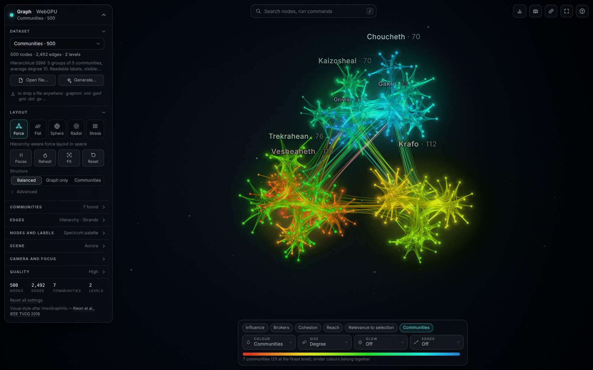
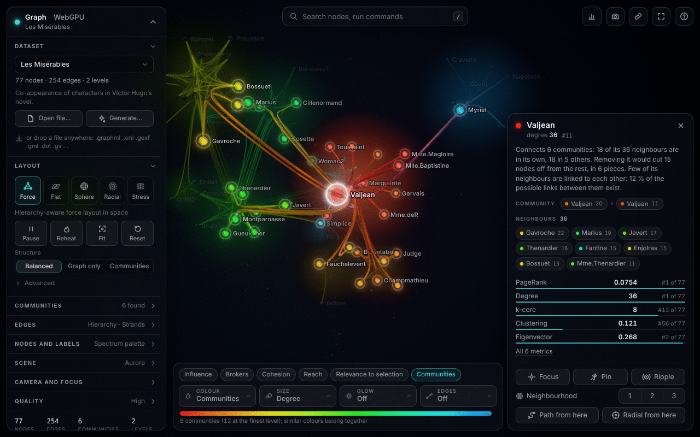
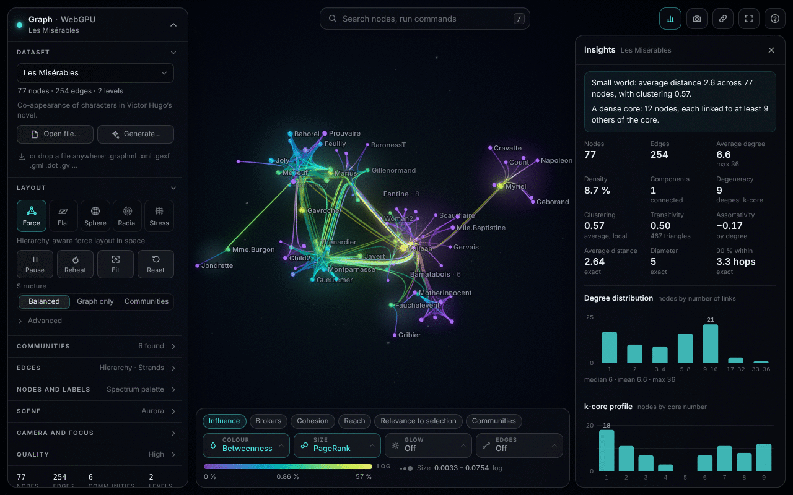
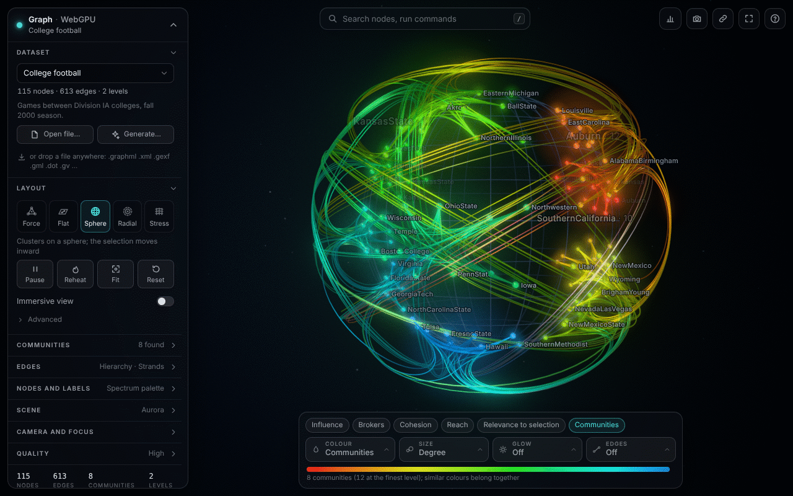
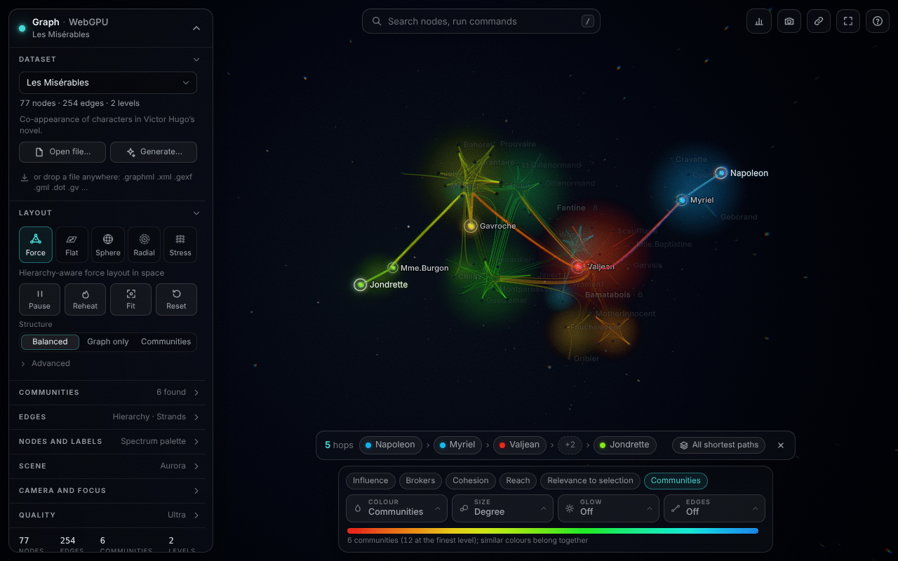
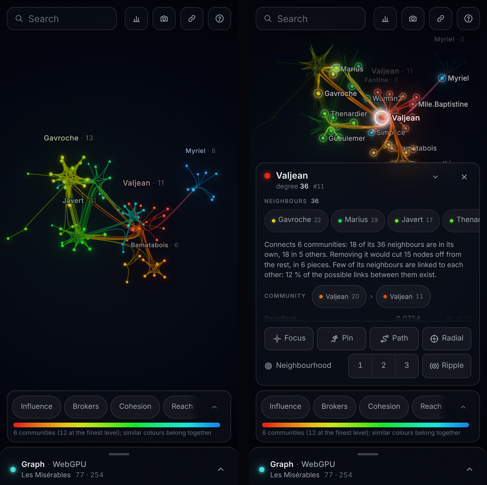

# webgpu-graph-vis

A 3D graph viewer for the browser, built on **three.js r187 `WebGPURenderer` and TSL**. It lays a graph out on the GPU, draws its edges as hierarchically bundled curves and its nodes as lit spheres, and adds tools for reading the graph: search, a metric lens, shortest paths, a summary of the graph in numbers and a short guided tour. The visual starting point is **ImsvGraphVis** (O.-H. Kwon, C. Muelder, K. Lee, K.-L. Ma, *A Study of Layout, Rendering, and Interaction Methods for Immersive Graph Visualization*, IEEE TVCG 22(7), 2016, [kwonoh/ImsvGraphVis](https://github.com/kwonoh/ImsvGraphVis)): a dark space, glowing bundled edges with a colour gradient from source to target, sphere nodes coloured by cluster, and the paper's sphere layout. The view and the interaction are made for ordinary desktop and phone screens, not for VR.



*A generated graph of 500 nodes (`generated/hsbm-500`) in the force layout at the high quality tier: community halos and names, hierarchy-bundled edges, the settings panel on the left, search at the top and the lens bar at the bottom.*

| | |
|---|---|
|  |  |
| A selected node: its edges become lit tubes, the rest of the graph dims, and the card describes the node. | The lens colours nodes by betweenness and sizes them by PageRank; the drawer on the right summarises the graph. |
|  |  |
| The sphere layout of the paper on the college football graph. | A shortest path with its hops in the path strip, at the ultra tier (depth of field on). |

All screenshots were rendered by headless Chromium on a software rasteriser (see [Limits and caveats](#limits-and-caveats)).

## Run it

```bash
npm install
npm run dev          # http://localhost:5173
```

```bash
npm test             # unit tests (node:test, no browser needed)
npm run build        # static site in dist/ (relative base, works from any sub-path)
npm run preview      # serves dist/
```

The app needs a browser with WebGPU: a current Chrome or Edge (113 or later), Safari 26 or later, or Firefox 141 or later on Windows. On Linux and on Android, Chrome may need WebGPU enabled in `chrome://flags`. A browser without WebGPU gets a message that says so instead of a blank page. There is no WebGL fallback.

The only runtime dependency is `three` (0.187.0); the build tool is Vite. Node 22 is what the deployment workflow uses.

## What you can do with it

### Explore the graph

- **Search and commands.** `/` or `Ctrl K` (`⌘ K` on a Mac) opens one box that finds nodes by label and runs commands. Enter selects the node and flies to it. A leading `>` lists commands only. Every setting-like action (layout modes, quality tiers, themes, looks, palettes, lens presets, "Colour by …", "Size by …", photo mode, the tour) is a command.
- **Selection and the node card.** A click selects a node. Its edges turn into solid tubes, the rest of the graph dims, and a ripple runs outward by hop distance. The card on the right says in two or three sentences how the node is connected, lists its communities, its neighbours by degree and its metrics with their rank, and offers the actions: focus, pin, ripple, neighbourhood within 1, 2 or 3 hops, path from here, radial layout from here.
- **Paths and neighbourhoods.** Shift-click a second node for the shortest path from the selection to it. The path strip at the bottom lists the hops and has a switch for all shortest paths. `1`, `2`, `3` show the neighbourhood of the selection within that many hops. `Esc` leaves one thing at a time: path, neighbourhood, community focus, selection.
- **Lens.** The lens bar maps a metric to the colour, the size or the glow of the nodes, and an edge metric to the opacity and width of the edges. Node metrics: degree, k-core, PageRank, eigenvector centrality, betweenness, closeness, harmonic centrality, clustering coefficient, triangles, connected component, and relevance to the selection (a random walk with restart). Edge metrics: shared neighbours, embeddedness, edge betweenness. Numeric and categorical node attributes of an opened file appear as further metrics. Presets set several channels at once (Influence, Brokers, Cohesion, Reach, Relevance to selection, Communities). The legend shows the real values at the ends of the ramp. Holding `C` flips back to the community colours for comparison.
- **Insights.** `I` opens a drawer with one or two plain observations (for example "small world", "a dense core"), the usual figures (density, components, degeneracy, clustering, assortativity, average distance, diameter), the degree distribution, the k-core profile, the top nodes by a chosen metric and the list of communities. A click on a community focuses and frames it.
- **Tour.** The command "Start the tour" plays a short visit: overview, the most connected node, the largest communities, the strongest broker, and back. Any input stops it where it is.

### Layouts

| Mode | What it is |
|---|---|
| Force 3D | The default: a hierarchy-aware force layout computed on the GPU. |
| Force 2D | The same physics in a plane. |
| Sphere | The layout of the paper: a treemap of the cluster hierarchy projected onto a sphere, with bundles arcing outside it. "Immersive view" puts the camera at the centre. |
| Radial | Shells by hop distance around the selected node (or the node of highest degree). |
| Stress | Positions whose distances match graph distances; suits meshes, rings and trees. Computed in a worker. |

Every switch animates from where the nodes are. Nodes can be dragged while the layout runs, and pinned (Shift-drag, or long-press on touch). The panel has three structure presets for the force modes (Balanced, Graph only, Communities) and, under "Advanced", sliders for separation, cohesion, hub spacing, size, repulsion and damping.

### Communities and bundling

- A file without a cluster hierarchy gets one from **Leiden** community detection, shaped into two to four nested levels. The Communities section can re-cluster the graph on screen with Leiden or Louvain and a resolution slider (larger values give more, smaller communities); the layout morphs into the new communities.
- **Bundling** has three modes: *Hierarchy* (edges run through the centres of the communities they cross, as in the paper), *Edge paths* (edges are routed along shortest paths of the settled layout, so a bundle never suggests a connection that is not there), and *Straight*. A strength slider goes from straight to fully bundled.
- A soft **halo** volume and a **name** mark each community at overview distance. Names give way to node labels as the camera comes close.

### Looks, themes and quality

- **Themes** set the environment: Aurora (the default), Studio, Void. **Looks** set several things together: Aurora, Classic (black ground and additive glow, as in the paper), Blueprint. There are four palettes (Spectrum, which is the paper's, Rainbow, Aurora, Ember), and sliders for node gloss and glow, key light, environment light, fog, depth motes, bloom and exposure.
- **Edge style** is strands or solid lit tubes ("auto" draws every edge as a tube on graphs of up to 120 edges; choosing tubes yourself works up to 50,000 edges). **Flow** sends pulses from source to target along the edges of the selection, or along all edges.
- **Quality** is `auto`, `low`, `medium`, `high` or `ultra` (see [Render pipeline](#render-pipeline)). `auto` picks a tier from the kind of device and, with "Dynamic resolution" on, lowers the render resolution when frames get slow. `auto` never picks `ultra`.

### Photo mode and share links

- **Photo mode** (`P`) hides the interface. A click on the picture sets the focus; a small bar sets blur and exposure and saves a PNG at 1×, 2× or 4× of the window size, within a budget that depends on the tier and the device.
- **The link button** copies an address that reopens the view: dataset, the settings that differ from the defaults, the camera pose, and the explore state (lens, selection, neighbourhood, path, community focus, insights). Quality is not part of a link, because it describes the device. Links work for the built-in datasets only: a graph from a file or from the generator is not in the address.
- Settings are saved in `localStorage`. A setting the app chooses per graph (for example the edge blend) stays automatic until you choose a value yourself.

### Open your own data

Drop a file on the window, or use "Open file…". The file is read in the browser; nothing is uploaded.

| Format | Extensions |
|---|---|
| GraphML (including yEd) | `.graphml`, `.xml` |
| GEXF (Gephi) | `.gexf` |
| GML | `.gml` |
| Graphviz DOT | `.dot`, `.gv` |
| Pajek | `.net`, `.paj` |
| Matrix Market | `.mtx` |
| Edge lists (CSV, TSV, text) | `.csv`, `.tsv`, `.txt`, `.edges`, `.edgelist`, `.el`, `.ssv`, `.tab`, `.ncol`, `.dat` |
| JSON: wgv-graph, ImsvGraphVis `.igv.json`, d3 / networkx node-link, Cytoscape.js, graphology / sigma, adjacency lists | `.json` |

Any of them may be gzipped (`.gz`). The content decides the format; the extension only breaks ties. Graphs are treated as undirected. Node labels, numeric and categorical node attributes, edge weights and groups (GEXF `modularity_class`, DOT subgraphs, nested GraphML graphs, …) are read where the format has them. The limits are 250,000 nodes, 1,000,000 edges and 256 MB per file. `public/data/samples/` holds one small graph in every format for trying this out.

"Generate…" builds a synthetic graph in the worker from one of ten models. [docs/DATASETS.md](docs/DATASETS.md) lists the built-in datasets, the generators and the format details.

### On a phone



*Pixel 7 emulation, `quality=auto`, which resolves to the low tier on a phone.*

Below 640 px of width the settings panel is a bottom sheet that rests as a slim bar, the lens bar folds to its presets and legend, and the node card is a sheet with the actions that Shift-click and the number keys perform on a desktop. The status chips are off by default.

### URL parameters

| Parameter | Meaning |
|---|---|
| `?ds=<id>` or `#<id>` | Built-in dataset, e.g. `imsv/lesmis`, `generated/hsbm-5k`. |
| `?layout=force\|flat\|sphere\|radial\|stress` | Layout mode at start. |
| `?autorotate=0\|1` | Idle auto-rotation. |
| `?quality=auto\|low\|medium\|high\|ultra` | Quality tier; wins over the saved setting. |
| `?hint=0\|1` | Never or always show the first-run hint. |
| `?s=`, `?c=`, `?x=` | The members of a share link: settings, camera pose, explore state. |
| `?governor=0\|1`, `?dynres=0\|1`, `?scale=<number>` | Frame-time governor, dynamic resolution, fixed render scale. |
| `?ao=`, `?dof=`, `?shadows=`, `?traa=`, `?sharpen=`, `?streak=`, `?vignette=`, `?grain=`, `?ca=`, `?post=` (`0\|1`) | Force single effects on or off (`post=0` strips all of them). |
| `?debug=ao\|depth\|velocity\|coc` | Show an intermediate buffer. |
| `?idle=0\|1\|<fps>`, `?gputime=0\|1`, `?noreadback` | Idle frame-rate cap, GPU timestamp queries, no position readback (development switches). |

## Keyboard and gestures

The table follows the two lists of the help overlay (`?`): mouse and keyboard, and the gestures it shows on a touch screen. Where touch has no gesture, the table names the control that does the same. Shortcuts do not fire while typing in a field.

| | Mouse and keyboard | Touch |
|---|---|---|
| Orbit | drag; arrow keys orbit in steps | drag with one finger |
| Pan | right-drag or Shift-drag | two fingers |
| Zoom | wheel (toward the pointer); `+` / `−` | pinch |
| Fit the graph | `F` or `Home`; double-click empty space | double-tap empty space |
| Select a node | click | tap |
| Fly to a node | double-click it | double-tap it |
| Move a node | drag it | drag it |
| Pin or unpin a node | Shift-drag it | long-press it |
| Shortest path from the selection | Shift-click the target | "Path" on the node card, then tap the target |
| Neighbourhood within 1 to 3 hops, off | `1` `2` `3`, `0` | "Neighbourhood" on the node card |
| Previous / next neighbour or search result | `[` `]` | |
| Search nodes and commands | `/` or `Ctrl K` (`⌘ K`) | the search field |
| Insights | `I` | the chart button |
| Compare metric colours with communities | hold `C` | |
| Pause or resume the layout | `Space` | "Pause" in the panel |
| Reheat the layout | `R` | "Reheat" in the panel |
| Labels: auto, all, off | `L` | |
| Photo mode | `P` | the camera button |
| Status chips | `H` | |
| Help | `?` | the help button |
| Leave one thing: path, neighbourhood, community focus, selection | `Esc` | tap empty space clears all |
| Open a graph | drop a file | "Open file…" in the panel |

Also on a mouse: middle-drag zooms and Ctrl-drag pans. In the immersive view of the sphere layout, drag looks around and the wheel changes the field of view.

## How it works

Node positions never leave the GPU on the way to the screen. The layout writes them in compute passes, and the node, edge, label and field shaders read the same storage buffers (`src/gpu/GraphBuffers.js`). The CPU gets an asynchronous readback for picking, label selection and camera fitting, which stops when the layout rests. Each part below is an App module (`src/app/App.js`) with a header comment that documents its technique and API in detail.

### Render pipeline

`src/render/gfx/RenderGraph.js` owns the scene pass and the post-processing chain and rebuilds them when the tier changes. `src/app/Quality.js` holds the tiers as data, resolves a setting into a configuration, and contains the frame-time governor. The chain, where a tier has the stage: HDR scene pass (RGBA16F) → ambient occlusion → anti-aliasing → depth of field → bloom → composite with vignette and exposure → Khronos Neutral tone mapping → sharpening or FXAA → grain and dither → label overlay.

| | Low | Medium | High | Ultra |
|---|---|---|---|---|
| Anti-aliasing | FXAA (none at a device pixel ratio of 2.5 or more) | MSAA 4× with alpha-to-coverage; SMAA above 20,000 edges | temporal (TRAA) with motion vectors | TRAA |
| Nodes | analytic shading, no texture taps | lit (PBR) | lit | lit with clear coat |
| Shadows | off | PCF, 1024² map | PCF, 2048² | PCF, 2048², wider penumbra |
| Ambient occlusion | off | GTAO at half resolution, bilateral upsample | GTAO at half resolution, temporal | GTAO at full resolution, 32 samples, temporal |
| Depth of field | off unless switched on | off unless switched on | off unless switched on | on |
| Bloom | quarter resolution | half | half | half, with an anamorphic streak |
| Lens | vignette, dither | + film grain | + film grain | + chromatic aberration, sharpening (RCAS) |
| Strands | flat shading | analytic strand light | analytic strand light | analytic strand light; defocus with the depth of field |
| Community halos, depth motes | off | on | on | on |
| Render pixel cap | 1.5 MP | 2.5 MP | 4 MP | 6 MP |

- `auto` starts at `high` on GPUs it recognises as discrete or as Apple silicon, at `medium` on integrated, mobile and unidentified GPUs and on tablets and small windows, and at `low` on phones and on software rasterisers. The governor then measures frame times: it lowers the scene resolution first, steps the tier down only when that does not help, and tries a higher tier again after a long good stretch (on desktops up to `high`; phones, tablets and small windows stay at or below the tier they started with). An explicit tier is never changed; only its resolution scale moves, and only while dynamic resolution is on.
- The labels are drawn in an overlay pass after tone mapping, at full resolution, with a camera that is not jittered by TRAA.
- A device that only offers WebGPU compatibility mode renders the low chain whatever is asked for.
- On touch devices the frame loop drops to 20 fps once nothing has changed for 2.5 seconds, and returns to the display rate on input.

### Nodes

`src/render/NodeRenderer.js`, `src/render/gfx/impostor.js`. Each node is one instanced, camera-facing quad. The fragment shader intersects the view ray with a sphere and hands the hit point, the normal and the depth to three's own `MeshStandardNodeMaterial` (`MeshPhysicalNodeMaterial` with clear coat in ultra), so the spheres are lit by the key light with PCF shadows and by the environment, and they cast round shadows because the billboard is built in `positionNode` and therefore faces the light in the shadow pass. An emissive core in the node colour feeds the bloom. A node that would be smaller than a minimum pixel radius is drawn as a point with the light its true disc would send, so distant leaves do not flicker.

`src/render/gfx/Environment.js` supplies the surroundings: a procedural sky rendered into a prefiltered cube map for image-based lighting (again only when a theme or light setting changes), a near-black backdrop, one directional key light whose shadow map is refitted to the graph and re-rendered only in frames in which something moved, fog in the materials, and the depth motes.

### Edges

`src/gpu/EdgeCurves.js`, `src/render/EdgeRenderer.js`, `src/render/gfx/strandSurface.js`.

- **Curve cache.** Every edge has an explicit control path: its two end nodes and, between them, references to nodes or to live cluster centroids. One compute kernel applies Holten's straightening by the bundling strength and evaluates a uniform cubic B-spline into a fixed number of samples per edge, with the arc length. It runs only when positions, the strength, the path set or the sphere parameters changed; a graph at rest costs no curve evaluation. The sample count falls with the edge count (a base of 32 segments per edge up to 2,000 edges, 8 above 100,000; more for long control paths and in the sphere layout) and is capped by a memory budget (64 MiB, 24 MiB on touch devices).
- **Strands.** One instanced draw for all edges: a screen-space ribbon per edge along the Catmull-Rom spline through the cached samples, alpha-blended with analytic coverage (no MSAA or dithering needed for thin lines), coloured by an OKLab gradient from the source hue to the target hue. From the medium tier on, strands get an analytic thin-fibre light term (averaged Lambert plus a Kajiya-Kay highlight).
- **Tubes.** Edges that are opaque anyway (those of the selected node, a highlighted path, or all edges in the "Tubes" style) are drawn a second time as depth-writing ribbons shaded as cylinders through three's lit material. Tubes are drawn in every tier; in the low tier they use an analytic light model. The hand-over between strand and tube is eased.
- **Flow.** Pulses travel along the arc length stored in the cache.

### Layout

`src/gpu/ForceLayout.js`, `src/gpu/forceKernels.js`, `src/graph/layouts.js`. The force model has a bounded short-range repulsion, a linear attraction whose weight falls with every hierarchy level a link crosses, a cohesion pull toward the centre of each node's finest cluster, and a weak gravity. Each node's force is divided by its diagonal stiffness (a Jacobi preconditioner), which keeps a step size of 1 stable for any degree. Repulsion is a Barnes–Hut walk over the cluster hierarchy itself, with large clusters split into spatial groups so the cost per node stays bounded. An auto-scale step keeps the layout at a fixed extent, so no parameter needs tuning per graph. The schedule holds full heat for the first 30 % of 200 ticks and then cools; a dragged node heats only its neighbourhood. The initial positions come from a stress solve of the cluster quotient graph, so connected communities start next to each other.

Sphere, radial and stress are target layouts: the positions are computed on the CPU (the stress layout in the data worker, by sparse stochastic gradient descent) and the GPU moves the nodes there with a critically damped spring.

### Clustering and bundling

`src/data/hierarchy.js`, `src/data/leiden.js`, `src/data/louvain.js`, `src/graph/bundling.js`, `src/data/bundle.js`. The cluster hierarchy drives the layout (cohesion, the Barnes–Hut tree, the seed), the hierarchical bundling and the colours (a hue range per subtree). The data worker takes isolated nodes and pairs aside, runs Leiden (or Louvain), and then adds levels around the result where the hierarchy is too wide or too shallow for the picture; these added levels are an aid for layout and bundling and are not counted as communities. A hierarchy that comes with the file is used as it is.

Hierarchical bundling follows Holten (2006) as used in ImsvGraphVis: the control points of an edge are the centroids of its end points' ancestors up to their lowest common ancestor. Edge-path bundling follows Wallinger et al. (2022) in its faster spanner variant (2023): each edge is routed along a short path of other edges of the graph, within a distortion bound. It runs in the worker on the settled layout, with a time budget of 3 seconds.

### Analytics and lens

`src/graph/analytics.js`, `src/analysis/`. Graph metrics are computed in a second Web Worker, so a long centrality run never delays a graph load. Betweenness, closeness and harmonic centrality use pivot sampling and arrive progressively: a coarse estimate first, refined on screen until exact while a channel shows them. The lens (`Lens.js`) normalises a metric with the scale that suits it (log, rank, robust or linear) and writes colour and radius targets that the GPU eases to. The tools (`Tools.js`) run breadth-first searches on the main thread for the ripple, the k-hop neighbourhood and shortest paths.

### Labels and community field

`src/render/TextLabels.js`, `src/render/sdfAtlas.js`, `src/render/ClusterField.js`. All glyphs of all labels are one instanced draw of signed-distance-field quads, positioned in the vertex shader from the live node positions; the CPU only decides a few times per second which labels show. The community halos are analytic volume integrals over one sphere per community, drawn before the edges.

## Project layout

```
index.html              the app page
src/
  main.js               composes the modules, wires every setting to them, URL and share links
  app/                  App (renderer, frame loop, modules, readback), Quality (tiers, governor)
  render/               NodeRenderer, EdgeRenderer, TextLabels, ClusterField, sdfAtlas
  render/gfx/           RenderGraph (pipeline and post chain), Environment, impostor helpers,
                        strand shading, depth of field, shared uniforms
  gpu/                  GraphBuffers, ForceLayout + forceKernels, EdgeCurves
  graph/                prepare (typed arrays for the GPU), layouts (stress, radial, seed),
                        bundling (control paths, edge-path bundling), analytics (metrics library)
  data/                 DataClient → worker: file formats, generators, Leiden / Louvain,
                        hierarchy shaping, bundling driver, export
  analysis/             analytics worker and client, Lens, Tools
  explore/              search and command palette, lens bar, insights, path strip, tour
  interact/             CameraRig, Interaction (pointer, keys, highlight model), Picking
  ui/                   settings schema and store, Panel, NodeCard, Hud, PhotoMode, Help, slots
  util/                 colour palettes and ramps
public/data/            built-in datasets, manifest.json, sample files in every format
dev/                    one focused page per subsystem (served by `npm run dev` only)
scripts/                dataset conversion and generation, manifest, headless screenshots
test/                   node:test unit tests of the pure logic
docs/                   DATASETS.md, screenshots
```

## Datasets

The picker has two groups; [docs/DATASETS.md](docs/DATASETS.md) has the tables.

- **ImsvGraphVis datasets** (`imsv/*`): the eight graphs of the paper with their original hierarchies, from karate (34 nodes) to C. elegans (297 nodes, 2,148 edges).
- **Generated** (`generated/*`): thirteen deterministic graphs from 192 to 20,000 nodes. `hsbm-500` and `lfr-2k` are good first choices; `hsbm-5k` has the cleanest nested communities; `hsbm-20k` (240k edges) and `lfr-20k-dense` (384k edges) are stress tests; `lattice-12`, `rgg-3k`, `mesh-torus` and `ws-2k` have a known shape that makes layout errors visible.

## Limits and caveats

- **No real-GPU measurements.** During development the app ran only in headless Chromium on SwiftShader, a CPU rasteriser, at roughly 1 to 5 frames per second (less at the high and ultra tiers). Correctness was checked there (screenshots inspected, console clean, unit tests for the pure logic), but this README makes no claim about frame rates. The tier contents, the pixel caps, the governor timings and the automatic tier choice are designed from pass and tap counts and tested with simulated frame times; they have not been tuned on real hardware. The status chips (`H`) show the frame rate and, where the browser allows timestamp queries, GPU time.
- **Large graphs.** The two 20,000-node presets load and render without errors, but at that size edges dominate the cost (`hsbm-20k` draws 5.3 million strand vertices per frame) and their speed on real GPUs is unknown. Above 150,000 edges the automatic edge blend is additive, which can wash out dense regions; choose "normal" under Edges → Advanced if it does.
- **Phones.** On a phone `auto` resolves to the low tier: no lit materials, shadows, ambient occlusion, halos or motes. The panel is a bottom sheet and the node card a sheet above it, which can cover nodes at the lower edge of the graph. The shaders of the low and medium tiers are written to stay within 8 storage buffers per stage, the default limit on phones; this was not run on a phone. The handling of a lost graphics device (a message with a reload into the same view) was only exercised by simulation.
- **GPU detection.** `auto` reads the adapter's vendor and architecture strings. A browser that masks them is treated as unknown and starts at `medium`.
- **Radial layout with bundling.** Community centres all lie near the middle in the radial layout, so bundling is capped at 0.3 there; dense graphs still read as busy.
- **Community names** sit above their community at a capped height and can end up beside it on large graphs.
- **Text files.** Content cannot tell a prose `.txt` or `.csv` from an edge list, so such a file opens as a small meaningless graph. Text must be UTF-8: UTF-16 is refused, and a legacy 8-bit encoding loads with replacement characters in the labels.
- **Directed and weighted graphs.** Direction is dropped. Weights are used by the clustering; the layout and the drawing do not use them.
- **Share links** carry no graph data, so they cannot reopen a dropped file or a generated graph.

## Headless testing

`npm run shot -- "/?ds=imsv/football&layout=sphere&quality=high"` starts Vite, opens the page in headless Chromium with WebGPU on SwiftShader, waits for `window.__ready`, saves a screenshot under `shots/` and prints a JSON report with console errors and page errors. Options: `--out`, `--size`, `--wait`, `--until`, `--eval`, `--report`, `--mobile`, `--dpr`, `--timeout` (see the header of `scripts/shot.mjs`). Playwright is not a dependency: install it globally or with `npm i -D playwright`. On a software rasteriser `quality=auto` resolves to low, so pass `quality=high` to see the lit look. `window.__ui` exposes the app, the settings and every module to `--eval` and to the console.

## Deploying

`.github/workflows/pages.yml` runs the tests, builds, and deploys `dist/` to GitHub Pages on every push to `main`. To turn it on, open **Settings → Pages** and set **Source** to **GitHub Actions**. GitHub Pages for a private repository needs a paid plan. `dist/` is a plain static folder with relative URLs, so any static host can serve it from any path.

## Credits

- Visual design, sphere layout, colour scheme and datasets: ImsvGraphVis by Oh-Hyun Kwon et al. The original data sources are listed in [docs/DATASETS.md](docs/DATASETS.md).
- Hierarchical edge bundling: D. Holten, IEEE TVCG 12(5), 2006.
- Edge-path bundling: M. Wallinger, D. Archambault, D. Auber, M. Nöllenburg, J. Peltonen, IEEE TVCG 28(1), 2022, and Computer Graphics Forum 42(6), 2023.
- Leiden: V. A. Traag, L. Waltman, N. J. van Eck, Sci. Rep. 9, 5233, 2019. Louvain: V. Blondel et al., J. Stat. Mech., 2008.
- Stress layout: J. X. Zheng, S. Pawar, D. F. M. Goodman, IEEE TVCG 25(9), 2019; sparse stress model: M. Ortmann, M. Klimenta, U. Brandes, JGAA 21(5), 2017.
- Rendering: [three.js](https://threejs.org), including its GTAO, TRAA, SMAA, FXAA and bloom nodes.

License: MIT.
