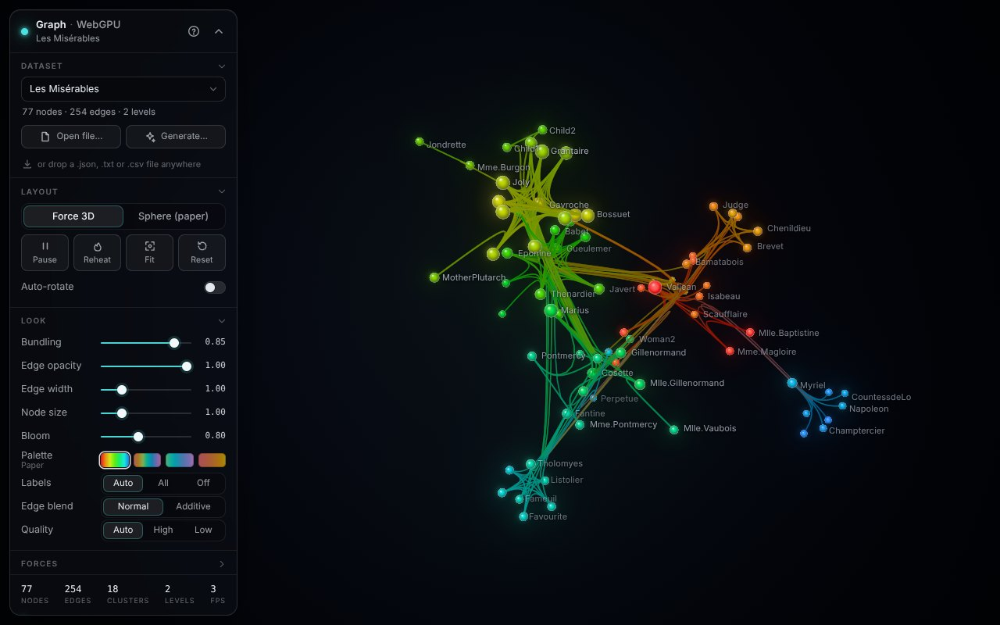
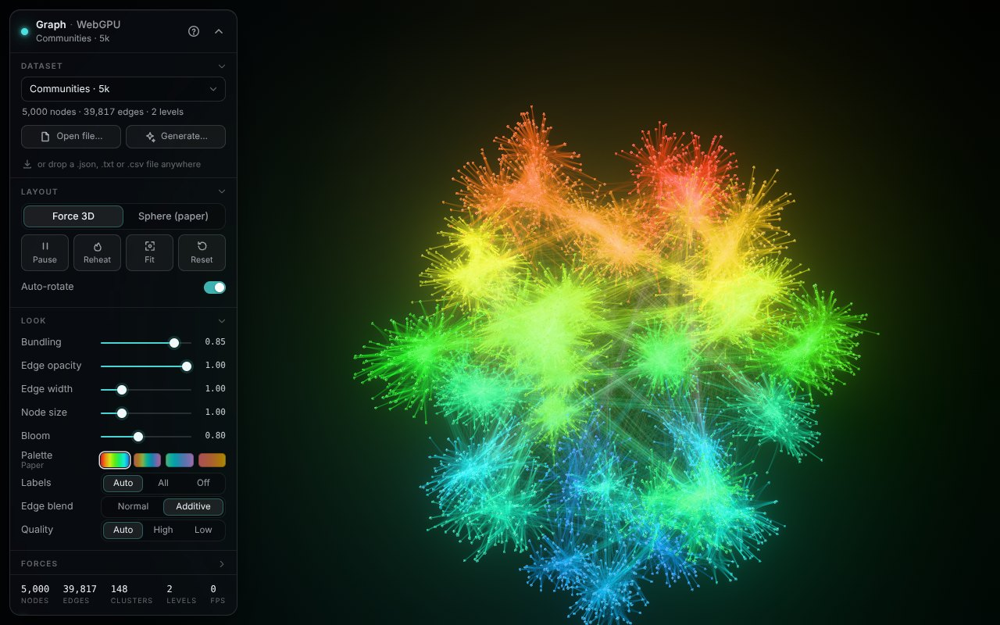
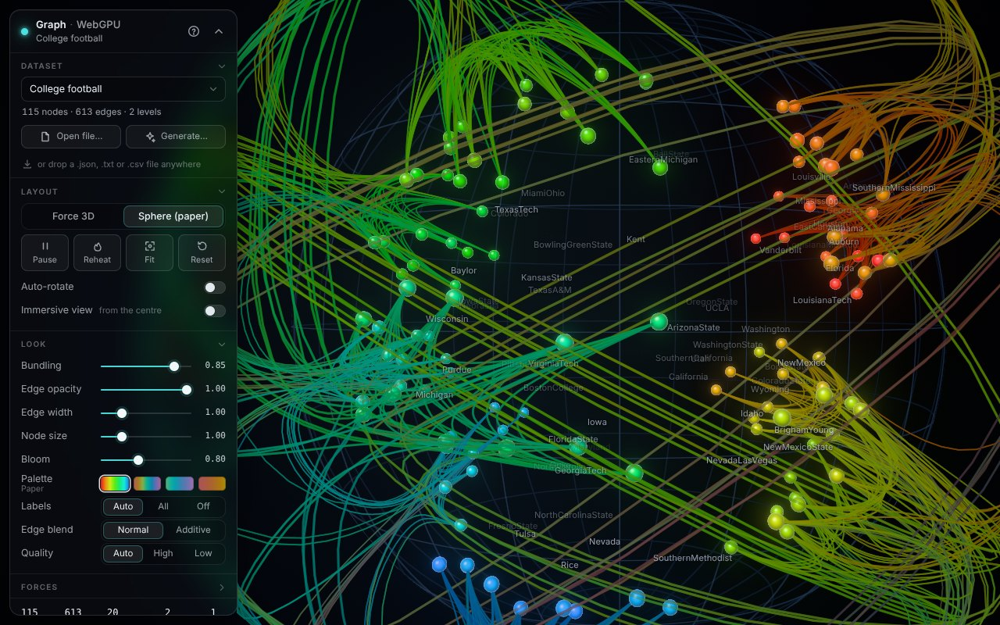

# webgpu-graph-vis

3D graph visualization in the browser, built on **three.js r187 `WebGPURenderer` + TSL**. It has a GPU force-directed layout, hierarchical edge bundling, and glowing, bloom-lit rendering. The visual style follows **ImsvGraphVis** (O.-H. Kwon, C. Muelder, K. Lee, K.-L. Ma, *A Study of Layout, Rendering, and Interaction Methods for Immersive Graph Visualization*, IEEE TVCG 22(7), 2016, [kwonoh/ImsvGraphVis](https://github.com/kwonoh/ImsvGraphVis)). The view and interaction are designed for normal desktop and mobile screens, not VR.

| Les Misérables (force 3D) | 5,000 nodes / 40k edges | College football (paper's sphere layout) |
|---|---|---|
|  |  |  |

## Quick start

```bash
npm install
npm run dev          # http://localhost:5173
```

It needs a browser with WebGPU: Chrome or Edge 113+, Safari 26+, or Firefox 141+ on Windows. Other browsers show a clear message instead of a blank page.

```bash
npm test             # 114 unit tests (node:test, no browser needed)
npm run build        # static site in dist/ (relative base, works from any sub-path)
npm run shot -- "/?ds=imsv/football&layout=sphere"   # headless WebGPU screenshot + error report
```

URL parameters:

- `?ds=<id>` picks a dataset, e.g. `imsv/lesmis` or `generated/hsbm-20k`.
- `?layout=sphere` starts in the paper's sphere layout.
- `?autorotate=0` turns off auto-rotation.
- `?quality=high|low` sets the render quality.

## Features

- **GPU force layout** with d3-force semantics: charge, link springs, gravity, velocity decay and alpha cooling. Everything runs in WebGPU compute shaders. Repulsion is Barnes–Hut, and the graph's own cluster hierarchy serves as the tree, walked stacklessly. It handles 20k nodes. Nodes can be dragged and pinned while the simulation keeps running.
- **Sphere layout (paper):** a squarified treemap of the hierarchy, projected onto a sphere, as in ImsvGraphVis. The view morphs smoothly between the force layout and the sphere. An "immersive" toggle puts the camera at the centre, which is the paper's in-sphere view adapted to a screen.
- **Hierarchical edge bundling** (Holten 2006): cubic B-splines run through the cluster centroids along each edge's hierarchy path, and centroids are recomputed on the GPU every frame. A bundling slider goes from 0 (straight) to 1 (fully bundled). Each edge is drawn as an instanced, screen-space ribbon with a colour gradient from source to target, in normal or additive blending.
- **Look:**
  - HCL colours in hierarchy order (the paper's palette, plus three alternatives).
  - Impostor sphere nodes with rim light and halo.
  - Bloom with neutral tone mapping.
  - A subtle background and a guide sphere.
  - Smart labels: all labels on small graphs; on larger ones, hovered, selected, neighbour and high-degree nodes, with collision culling.
- **Interaction:**
  - Orbit, pan and zoom to cursor.
  - Hover and select with neighbourhood highlight and context dimming.
  - A node card.
  - Double-click to fly to a node.
  - Fit, auto-rotate and reduced-motion support.
  - Drag & drop of graph files.
- **Data:**
  - Formats: wgv-graph JSON, ImsvGraphVis `.igv.json`, d3 and networkx node-link JSON, and text or CSV edge lists, plain or gzipped.
  - Louvain clustering builds the hierarchy when a file has none.
  - Synthetic generators (hierarchical SBM, LFR, BA, WS, 3D geometric, lattice, caveman).
  - Everything runs in a Web Worker.
- **Responsive UI:** a glass side panel on desktop and a bottom sheet on phones, with touch gestures.

### Controls

| | Desktop | Touch |
|---|---|---|
| Rotate | drag | one finger |
| Pan / zoom | right-drag / wheel (zooms to cursor) | pinch |
| Select | click (empty space clears) | tap |
| Move node | drag a node | drag a node |
| Pin / unpin | Shift + drag | long-press |
| Focus / fit | double-click node / empty | double-tap |
| Keys | `Esc` clear · `F` fit · `Space` pause · `R` reheat · `L` labels · `?` help | |

## Datasets and recommended sizes

The picker has two groups. [docs/DATASETS.md](docs/DATASETS.md) has full tables, generator parameters and accepted file formats.

- **ImsvGraphVis datasets** (`imsv/*`): the 8 graphs from the paper, with their original Louvain hierarchies. They range from karate (34 nodes, 78 edges) to C. elegans (297 nodes, 2,148 edges). They are converted by `npm run data:convert`.
- **Generated ladder** (`generated/*`): a deterministic set, built by `npm run data:generate`. The two 20k graphs are stored as specs and generated in the worker in about half a second.

| Tier | Size | Use it for | Presets |
|---|---|---|---|
| **Readable** | ~100–1,000 nodes, avg degree 4–10 | The paper's look, labels, tracing single edges | `imsv/*`, `caveman-24` (192), `hsbm-500` |
| **Structure overview** | 1k–5k nodes, avg degree 8–16 | Bundles show which clusters talk to each other; best balance of beauty and insight | `lfr-2k`, `hsbm-5k`, `ba-5k` |
| **Stress / target** | 10k–20k nodes, avg degree 20–40 | GPU cost, overdraw, mobile limits | `lfr-10k`, `hsbm-20k` (240k edges), `lfr-20k-dense` (384k edges) |
| Sanity | – | Known geometry that makes layout bugs obvious | `lattice-12`, `rgg-3k`, `ws-2k` |

Recommendations:

- **Develop on** `imsv/lesmis`, `imsv/football` and `hsbm-500`. They load instantly, they cover the labels, the bundling and the sphere layout, and any visual regression is easy to spot.
- **Judge visual quality on** `hsbm-5k`. Its clean nested communities are what hierarchical bundling is made for. Up to about 5k nodes and 50k edges is the sweet spot, where the image stays readable and smooth.
- **Measure performance on** `hsbm-20k` and `lfr-20k-dense`. At this size edges dominate the frame: 240k–384k ribbons × 8–12 segments. Additive blending switches on automatically above 20k edges. On phones, use `quality=low`.
- Graphs without community structure, like `ba-5k`, bundle poorly whatever their size. Expect that rather than treating it as a bug.

## Architecture

```
src/
  main.js               wires everything together (settings ↔ modules, dataset loading, URL params)
  app/App.js            WebGPURenderer, scene, camera, RenderPipeline, module system, async position readback
  graph/prepare.js      PreparedGraph: CSR adjacency, hierarchy tables, LCA per edge, BH tree, colours, initial + sphere positions
  gpu/GraphBuffers.js   all storage buffers (instancedArray) + shared uniforms
  gpu/ForceLayout.js    compute pipeline: centroids → Barnes–Hut → links → integrate; drag/pin API; force ↔ sphere morph
  render/               EdgeRenderer (bundled ribbons), NodeRenderer (impostors + halo), Labels, Background, PostFX (bloom/tone map)
  interact/             CameraRig (fit, fly-to, auto-rotate, immersive), Picking (CPU, from readback), Interaction (pointer/touch/keys/drop)
  ui/                   Panel (desktop panel / mobile sheet), NodeCard, ui.css
  data/                 DataClient → worker: parse, Louvain, generators, prepare (typed arrays transferred)
dev/                    focused dev pages per subsystem (served by `npm run dev` only)
scripts/                data conversion/generation, manifest, headless screenshot harness
```

Node positions stay on the GPU. The layout writes `nodePos` in compute, and the node, edge and label stages read it directly. The CPU only gets an asynchronous readback, which it uses for picking, labels and camera fitting, so the frame never stalls on it.

## Performance status

Everything has been verified for correctness: the layout converges, the Barnes–Hut error is about 3–6% at θ = 0.8, and the GPU bundled curves match a CPU reference. All datasets, including the 20k / 240k-edge preset, load without errors. **Frame rates on real GPUs have not been measured yet.** The automated checks run on SwiftShader, a CPU software rasterizer, where every graph is slow. On real hardware, the first numbers to collect are frame time on `hsbm-5k`, `hsbm-20k` and `lfr-20k-dense`, on desktop and on a phone. The FPS counter in the panel footer shows them.

## Headless testing

`npm run shot` starts Vite and opens the page in headless Chromium with WebGPU on SwiftShader. It then waits for `window.__ready`, saves a screenshot in `shots/`, and prints a JSON report of console errors and page errors. Options include `--mobile`, `--size`, `--wait`, `--until`, `--eval` and `--report`; see `scripts/shot.mjs`. Playwright isn't a dependency, so install it globally or with `npm i -D playwright`. The Chromium flags in the script matter: without the ANGLE/SwiftShader GL flags, the WebGPU canvas loses its device.

## Deploying

`.github/workflows/pages.yml` runs the tests, builds, and deploys `dist/` to GitHub Pages on every push to `main`. To turn it on, open **Settings → Pages** and set **Source** to **GitHub Actions**. GitHub Pages for a **private** repository needs a paid plan. Alternatively, `dist/` is a plain static folder that any static host can serve.

## Credits

- Visual design, sphere layout, colour scheme and datasets: ImsvGraphVis by Oh-Hyun Kwon et al. The original data sources are listed in [docs/DATASETS.md](docs/DATASETS.md).
- Hierarchical edge bundling: D. Holten, IEEE TVCG 12(5), 2006.
- Louvain: V. Blondel et al., J. Stat. Mech., 2008.
- Rendering: [three.js](https://threejs.org).

License: MIT.
